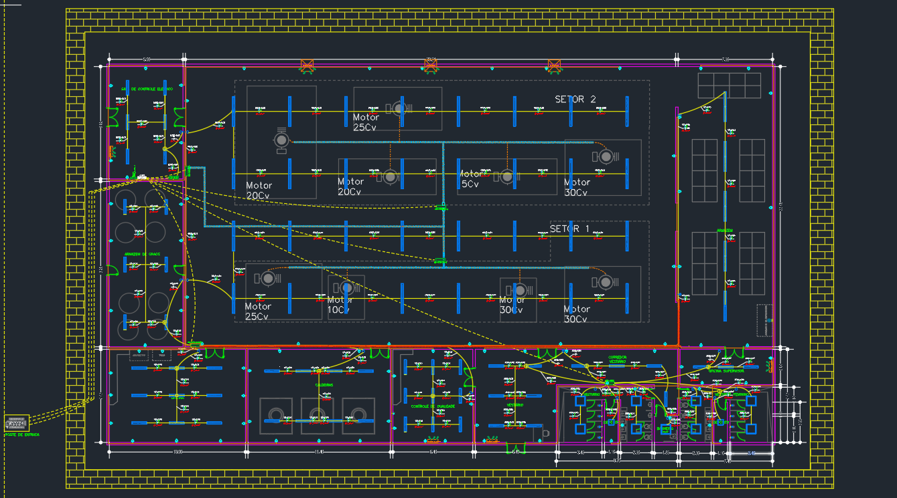

# Projeto de instalações — Fábrica de Massas

Repositório dos arquivos técnicos disponíveis do projeto de instalações da Fábrica de Massas.

## Estrutura

- `projeto/cad/`: desenho principal em DWG.
- `projeto/memorial/`: memorial descritivo editável (DOCX) e versão em PDF.
- `projeto/luminotecnica/relatorios/`: 14 relatórios em PDF, organizados por ambiente nos nomes dos arquivos.
- `referencias/motores/`: cinco documentos de motores, mantidos com os nomes originais.
- `referencias/transformador/`: desenho DWG identificado como transformador de 300 kVA.
- `docs/inventario.csv`: origem, localização atual, tamanho e SHA-256 de cada arquivo.
- `docs/ORGANIZACAO.md`: convenções de manutenção e próximos passos.

## Uso

Abra os PDFs em um leitor de PDF, o memorial editável em um editor compatível com DOCX e os desenhos em software compatível com DWG.

Esta organização foi feita a partir dos nomes e pastas dos arquivos. Não representa revisão técnica, validação de dimensionamento ou confirmação de conformidade normativa. O conteúdo técnico e a correspondência entre o DOCX e o PDF ainda precisam ser revisados.

## Controle de versão

O repositório usa Git localmente. Não há publicação ou repositório remoto configurado. Consulte `docs/ORGANIZACAO.md` antes de atualizar documentos.

## Enunciado da disciplina

Consulte [dados do professor e pontos a esclarecer](docs/ENUNCIADO.md), com o PDF original recebido e uma lista de conferências propostas.

